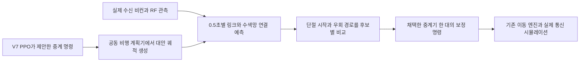

# 예측값이 예방 재배치 명령에 들어가는 경로

## 기존 V7 PPO

각 중계기가 실제 수신한 20초 이력을 Transformer가 처리한다. 링크별 32차원 표현과 다음 지속 단절의 시각 분포를 산출한다. 시각 분포는 다음 8초를 0.5초 단위로 나눈 16구간과 8초 이내 단절 없음으로 구성된다.

| 예측에서 전달하는 값 | 재배치에서 쓰는 곳 |
|---|---|
| 링크별 32차원 표현의 유효 링크 평균 | PPO 행동망의 상태 문맥 |
| 5초 미만·3~4초·3~7초·7초 미만 단절 확률의 평균과 최댓값 | PPO 행동망의 상태 문맥 |
| 근거가 있는 링크 비율 | PPO 행동망의 관측 범위 표시 |
| 링크별 5초 미만 위험과 3~7초 위험 | 후보별 6초 후 링크 여유 개선량에 곱해서 후보 점수에 가산 |

후보 점수의 위험 가중치는 3~5초 구간이 겹친 합계다. PPO는 위험을 참고해 중계기마다 25개 보정 후보의 순위를 매긴다. 위험이 높은 링크가 수색망의 필수 경로인지는 이 점수만으로 결정되지 않는다. 자세한 원본 연결은 [V7 및 V17 인터페이스](../forecast_prevention/INTERFACE.md)에 기록했다.

## V18의 추가 경로

이동 후보 비교와 명령 적용은 3초마다 수행한다. 예측하는 미래 구간을 0.5초 단위로 쪼갠다.

1. PPO와 같은 후보 마스크를 사용한다. 기존 명령과 각 중계기 상위 7개 대안, 명목 보정 0을 비교한다. 한 번에 보정 명령 한 개를 변경한다. 공동 충돌 회피 때문에 다른 기체의 실현 위치도 달라질 수 있어 편대 전체의 이동을 다시 계산한다.
2. 기존 경로·속도·기체 간 최소 거리·임무 보호 제한으로 다음 3초의 후보를 해석한다. 뒤 구간은 같은 명령을 유지한다는 가정으로 8.5초까지 연장한다. 현시각의 실제 항법 상태를 중앙 비행 계획기가 공유한다는 조건이 있다. 실제 채널 정답·간섭원 위치·간섭 일정·미래 수신 기록은 후보 점수에 넣지 않는다.
3. 지도 손실과 실제 받은 수신 전력·SINR에서 구한 잡음으로 양방향 링크 여유를 예측한다. 수색기 쌍마다 중계기를 포함한 최선 경로를 구하고 그중 가장 약한 경로의 여유를 사용한다. 새 단절은 음수 여유가 두 프레임 연속 이어질 때 센다. 현재 수색기 비컨이 오래됐거나 첫 중계기에 최근 RF 근거가 없으면 PPO 명령을 사용한다.
4. 예측기가 이동 선택기에 전달하는 값은 **후보별 시간별 연결 여유(dB), 예상 단절 시작(초), 누적 부족량(dB·초), 취약 시점에서 링크 하나를 제거한 뒤 남는 최저 여유, 첫 3초의 공동 이동 종점**이다. 후보를 비교할 때 쓰는 물리 점수이며 보정된 발생 확률은 아니다.
5. 현재 연결된 것으로 추정할 때, 앞 구간을 더 위험하게 만들지 않으면서 예상 새 단절 횟수와 음수 여유 시간을 줄이는 경우에만 기존 명령을 바꾼다. 비슷한 후보는 우회 경로 여유와 이동 거리를 함께 비교한다. 이미 단절로 추정된 상태에서는 이후 음수 여유 시간과 부족량을 줄이는 복구도 허용한다.
6. 최종 전달값은 **어느 중계기, 어느 보정 후보, 언제 적용할지**다. 세계 시뮬레이터에는 기존 인터페이스와 같은 보정 배열이 들어간다. 실제 실행과 통신 결과는 따로 기록한다. 경보 자체는 이동 명령의 근거 중 하나다.

간섭 전환 실험은 첫 중계기와 최소 한 수신 지점에서 추정 잡음이 −103 dBm 이상이고, 최근 변화율이 0.4 dB/s 이상일 때 적용한다. 기본 궤적의 기하 모델이 먼저 지속 단절을 예측하면 기하 모델을 유지한다. 간섭 외삽 상한은 5 dB다. 큐만 커질 경우 이동 이유로 사용하지 않고 기록한다.

경보는 PPO 행동을 고정한 비행에서 평가한다. 개입 후 단절이 사라지는 경우에는 개입하지 않은 동일 조건이 비교 기준이다. 따라서 경보 성능, 개입 횟수, 피한 단절 수를 분리한다.
