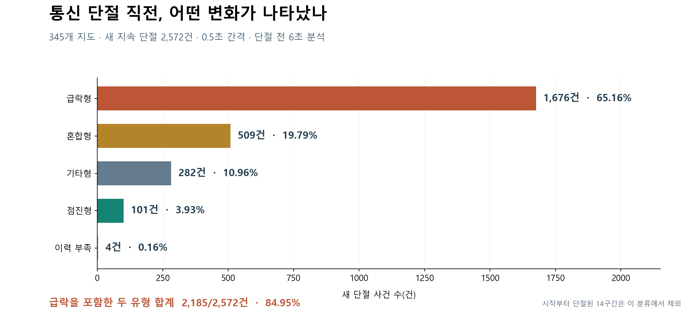
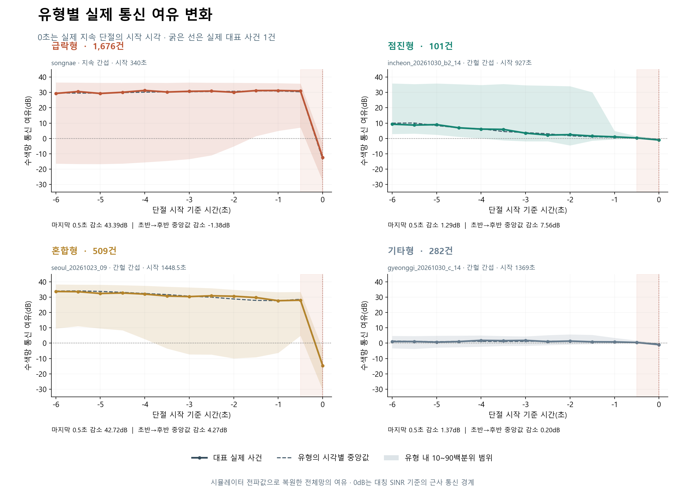
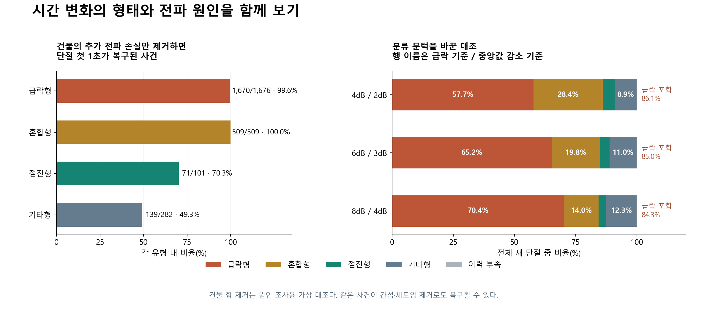

# Final V1 · 급락형·점진형·혼합형 단절 분석

345개 지도에서 V7 PPO가 수행한 345개 비행을 대상으로, 새로 시작한 지속 단절 2,572건을 분류했다. 각 지도에는 비행 방향과 난수 한 세트를 배정했다. 무간섭·간헐 간섭·지속 간섭 중 실제 제어 비행에 사용한 조건의 기록을 분석했다. 시작 시점부터 연결이 끊긴 14구간은 새 단절 분모에서 제외했다.

## 통신 여유와 단절의 의미

수색기 한 쌍을 잇는 직접 링크와 중계 경로를 모두 고려한다. 경로에 포함된 가장 약한 링크의 여유가 가장 큰 경로를 각 수색기 쌍에서 고르고, 그중 가장 약한 쌍의 값을 수색망 통신 여유로 정의했다. 단위는 dB다. 양수일수록 통신 경계까지 여유가 있고 음수는 기준 미달을 뜻한다.

그래프의 여유는 방향별 SINR과 대칭 임계값으로 근사한 값이다. 실제 지속 단절은 데이터·ACK 성공확률 기준의 링크로 수색망이 1초 이상 연결되지 않는 구간이다. 해당 실제 판정은 원본 기록과 동일하게 재현했다.

## 정확한 분류 기준

각 사건에서 단절 시작을 0초로 맞추고 -6초부터 0초까지 0.5초 간격의 13개 값을 사용했다. 두 양을 계산했다.

- 마지막 급락량 J는 -0.5초의 여유에서 0초의 여유를 뺀 값이다.
- 앞선 감소량 D는 -6~-4.5초의 네 값 중앙값에서 -2~-0.5초의 네 값 중앙값을 뺀 값이다.

| 유형 | 정확한 조건 | 의미 | 건수 | 비율 |
|---|---|---|---:|---:|
| 급락형 | J ≥ 6dB, D < 3dB | 앞선 구간의 감소 기준을 충족하지 않고 마지막에 크게 하락 | 1,676 | 65.16% |
| 혼합형 | J ≥ 6dB, D ≥ 3dB | 앞서 여유가 줄고 마지막 0.5초에도 크게 하락 | 509 | 19.79% |
| 점진형 | J < 6dB, D ≥ 3dB | 앞서 여유가 줄며 마지막 급락 기준은 충족하지 않음 | 101 | 3.93% |
| 기타형 | J < 6dB, D < 3dB | 두 감소 기준은 작지만 실제 지속 단절이 발생 | 282 | 10.96% |
| 이력 부족 | 시작 전 6초 자료 부족 | 같은 길이의 이력으로 분류하기 어려움 | 4 | 0.16% |

6dB와 3dB는 이 분석에서 정한 연구용 분류 문턱이다. 점진형은 두 구간의 중앙값 감소를 뜻하므로 모든 0.5초 구간에서 일정하게 감소한다는 의미를 포함하지 않는다. 혼합형은 시간 변화의 두 조건을 함께 만족한 경우다. 물리 원인이 두 가지 이상이라는 뜻은 별도의 원인 조사에서 판단한다.

급락형과 혼합형 합계는 2,185/2,572건, 84.95%다. 이 비율은 단절 시작 시점까지 포함한 사후 분류다. 단절 3초 전에 같은 급락을 관측했다는 비율로 해석할 수 없다.

## 실제 대표 사례

각 유형의 시각별 중앙값에 가장 가까운 실제 사건을 선택했다. 각 시각의 사분위 범위로 차이를 정규화한 평균 절대거리를 사용했다. 유형 전체의 중앙값과 10~90백분위 범위도 함께 표시했다. 원본 파형을 매끈하게 만들지 않고 저장된 반초 값을 연결했다. 사건 시작 전 6초에는 앞선 별도 단절과 회복이 포함될 수 있어 일부 유형의 10백분위가 0dB 아래에 있다. J와 D의 두 조건으로 현재 사건의 유형을 정했다.

| 유형 | 대표 지도 | 간섭 조건 | 단절 시작 | J | D | 지속 시간 |
|---|---|---|---:|---:|---:|---:|
| 급락형 | songnae | 지속 간섭 | 340초 | 43.39dB | -1.38dB | 1초 |
| 점진형 | incheon_20261030_b2_14 | 간헐 간섭 | 927초 | 1.29dB | 7.56dB | 5.5초 |
| 혼합형 | seoul_20261023_09 | 간헐 간섭 | 1448.5초 | 42.72dB | 4.27dB | 12초 |
| 기타형 | gyeonggi_20261030_c_14 | 간헐 간섭 | 1369초 | 1.37dB | 0.20dB | 4.5초 |

급락형 대표는 약 30dB의 여유를 유지하다 마지막에 -12.40dB로 내려간다. 점진형 대표는 9.28dB에서 0.28dB까지 낮아진 뒤 -1.01dB에 도달한다. 혼합형 대표는 초반 약 33dB에서 후반 약 28dB로 약해지고 마지막에 -14.69dB가 된다. 기타형 대표는 처음부터 약 1dB의 작은 여유를 갖고 있다가 0dB 아래로 내려간다. 큰 하락이 없어도 통신 경계 가까이에서 단절할 수 있다.

## 유형별 지속 시간과 지도 수

| 유형 | 사건이 나온 지도 수 | 지속 시간 중앙값 | 지속 시간 90백분위 |
|---|---:|---:|---:|
| 급락형 | 278 | 4초 | 14.00초 |
| 혼합형 | 199 | 4초 | 13.50초 |
| 점진형 | 71 | 2.5초 | 10.00초 |
| 기타형 | 97 | 2초 | 8.45초 |
| 이력 부족 | 4 | 5초 | 11.85초 |

같은 지도가 여러 유형에 포함될 수 있다. 90백분위는 해당 유형 사건의 90%가 그 시간 이내에 끝났음을 뜻한다. 파형이 어떻게 떨어졌는지와 단절이 얼마나 오래 지속됐는지는 구분한다.

## 물리 원인과의 관계

| 유형 | 건물 추가손실만 제거해 첫 1초 복구 | 간섭만 제거해 복구 | 섀도잉만 제거해 복구 |
|---|---:|---:|---:|
| 급락형 | 1670/1676 (99.6%) | 72/1676 | 4/1676 |
| 혼합형 | 509/509 (100.0%) | 31/509 | 1/509 |
| 점진형 | 71/101 (70.3%) | 63/101 | 34/101 |
| 기타형 | 139/282 (49.3%) | 235/282 | 128/282 |
| 이력 부족 | 4/4 (100.0%) | 0/4 | 0/4 |

같은 실제 위치와 외생 상태를 두고 각 손실 항을 제거한 가상 대조다. 한 사건이 건물 항 제거와 간섭 제거에서 각각 복구될 수 있으므로 행의 세 원인 수는 겹친다. 한 가지 원인에 사건을 독점 배정한 표가 아니다.

급락형 1,676건 중 1,670건과 혼합형 509건 전부는 건물 항만 제거해 첫 1초가 복구됐다. 이 시뮬레이션에서는 이동 경로가 건물 차폐에 들어가는 지점을 미리 계산하는 접근을 뒷받침한다. 점진형도 101건 중 71건이 같은 대조에서 복구됐으므로 시간 변화 형태 하나만으로 전파 원인을 단정할 수 없다.

## 문턱에 따른 민감도

| 급락 J / 감소 D 문턱 | 급락형 | 혼합형 | 점진형 | 기타형 | 이력 부족 | 급락 포함 비율 |
|---|---:|---:|---:|---:|---:|---:|
| 4 / 2dB | 1,485 | 730 | 124 | 229 | 4 | 86.12% |
| 6 / 3dB | 1,676 | 509 | 101 | 282 | 4 | 84.95% |
| 8 / 4dB | 1,810 | 359 | 82 | 317 | 4 | 84.33% |

문턱을 바꾸면 급락형과 혼합형 사이에서 사건이 이동한다. 급락을 포함한 합계는 세 기준에서 약 84~86%였다. 개별 유형의 정확한 비율은 문턱을 함께 명시해야 한다.

## 선행 예측으로 연결할 때의 해석

이 파형은 시뮬레이터에서 복원한 전체 수색망의 실제 전파 변화다. 예측기가 받을 수 있는 자료는 그 시점까지 실제로 수신한 비컨·패킷·ACK다. 전체망의 급락이 다른 위치에서 일어나거나 급락과 함께 보고가 사라지면 첫 중계기가 같은 모양을 관측하지 못할 수 있다.

별도의 관측 변화 검증은 알려진 지도 14개의 새 난수 42비행·216사건에서 수행했다. 첫 중계기의 단절 3초 전 관측에서 직전 0.5초 6dB 이상 감소는 8/216건이었다. 현재 3초 제어 경계에서는 1초 주기 비컨의 0.5초 차분이 모두 결측이었고 ACK의 차분은 2.3% 시점에서 가능했다.

기존 예정 경로·차폐 특징에 실제 관측 변화량을 추가한 모델과 같은 설정의 기존 특징 모델은 문턱 세분화 대조에서 모두 119/216건, 55.09%를 선행 탐지했다. 따라서 이번 데이터에서는 0.5초 급락 빈도를 곧바로 높은 선행 탐지율로 연결할 근거가 확보되지 않았다. 유형별 파형은 예정 경로에서 차폐될 위치를 미리 계산할 필요성과, 미리 확보한 관측 정보의 범위를 함께 점검하는 데 사용할 수 있다.

## 근거와 재현 범위

- 원자료는 Final V1의 causes.json이며 SHA-256은 e412b7029c710968df5d20310b7bbb5e85567797133c7877f1b755eabadc9b82다.
- 분류 코드의 해시, 유형별 합계, 문턱별 합계와 실제 사례의 분류를 확인했다.
- 저장된 파형은 소수 둘째 자리로 반올림돼 있다. 이 값으로 재분류했을 때도 원래 분류와 모두 일치했다.
- 그래프의 대표 사건은 유형 전체의 통계와 구분하며 전체 수신 환경의 대표성을 보장하는 표본으로 해석하지 않는다.
- 지도별 비행 방향과 난수 한 세트의 시뮬레이션 분석이다. 실제 장비 시험과 별도다.

[도표용 집계와 대표 사건](evidence.json)
